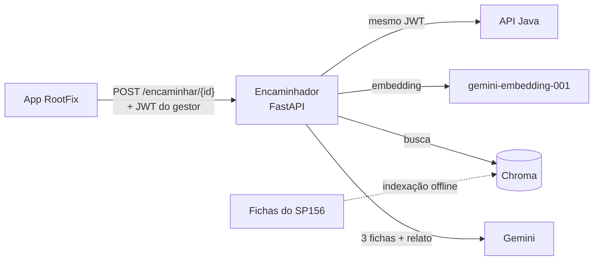

# RootFix IA · Encaminhador do gestor

**Global Solution 2026/2 · FIAP · CitizenTech**
Disciplina: Disruptive Architectures: IoT, IoB & Generative IA
Grupo **Rooted**

| Integrante | RM |
|---|---|
| João Victor Caetano | 562074 |
| João Victor Bueno Castelini | RM a preencher |
| Felipe Furlanetto | RM a preencher |
| Raul Rezende | RM a preencher |
| Ryan Vetoriano | RM a preencher |

Vídeo de demonstração: _link a preencher_

---

## A funcionalidade

O **RootFix** é um app de zeladoria urbana por comunidade: moradores publicam problemas do bairro (buraco, poste apagado, entulho), os vizinhos apoiam e comentam, e o gestor da comunidade (uma associação de bairro, por exemplo) adota os problemas que vai acompanhar.

Adotar não resolve nada sozinho: o gestor ainda precisa saber **a quem cobrar**. A prefeitura de São Paulo tem dezenas de serviços no SP156, organizados por subprefeitura, e escolher o serviço certo e escrever um pedido bem fundamentado toma tempo de quem faz isso como voluntário.

O **Encaminhador do gestor** resolve essa etapa. Quando o gestor toca em "Encaminhar com IA" num problema adotado, ele recebe:

1. qual serviço da prefeitura resolve o problema;
2. o órgão, o canal, o prazo e as informações pedidas, quando a ficha oficial informa;
3. um texto de solicitação pronto para colar no SP156, com o resumo do que os vizinhos relataram;
4. a página oficial usada, sempre citada.

**Público beneficiado:** gestores de comunidade no RootFix e, por meio deles, os moradores, cujos problemas chegam ao canal certo com mais informação.

**Contribuição para o RootFix:** fecha o ciclo "relatar → adotar → **encaminhar** → acompanhar". A outra IA do projeto (Spring AI na API Java) classifica categoria e gravidade pela foto na publicação; o Encaminhador usa essa categoria como ponto de partida e cuida do que vem depois da adoção.

## Como atende os requisitos

| Requisito | Onde está |
|---|---|
| 01 · Aplicação ao problema | Esta seção; público e contribuição acima |
| 02 · IA generativa no fluxo | Gemini escreve a solicitação e o resumo dentro do `POST /encaminhar/{id}`, chamado pelo app ([gerador.py](app/gerador.py)) |
| 03 · Aprofundamento técnico | RAG básico sobre fichas oficiais do SP156: embeddings, base vetorial, busca filtrada por categoria e limiar ([busca.py](app/busca.py)); justificativa abaixo |
| 04 · Dados e arquitetura | [docs/dados.md](docs/dados.md) (fontes e preparação) e [docs/arquitetura.md](docs/arquitetura.md) (fluxo e decisões) |
| 05 · Avaliação dos resultados | [docs/avaliacao.md](docs/avaliacao.md): casos rotulados, métricas de busca e de geração, casos de falha e testes de integração |
| 06 · Organização e uso responsável | Instruções abaixo, `.env` fora do Git, anonimização antes do Gemini, limitações explícitas |

## Arquitetura



1. O app manda o id do problema e o token do gestor.
2. O serviço lê o problema e as observações na API Java **com o mesmo token**: quem decide o acesso é o Java. Só segue se o problema foi adotado e quem pediu é o gestor da comunidade.
3. Descarta autores e coordenadas e tira e-mail, telefone, CPF e número da casa do texto.
4. Busca as fichas mais parecidas, filtrando pela categoria que o Spring AI deu. Se a busca filtrada for fraca (o Spring AI pode errar), busca na base toda. Abaixo do limiar, responde que não encontrou, **sem chamar o Gemini**.
5. Manda ao Gemini as 3 melhores fichas e o relato. O Gemini escolhe a ficha (ou diz que nenhuma serve) e escreve a solicitação, em JSON estruturado.
6. **Serviço, órgão, canal, prazo e fonte saem da ficha escolhida, nunca do modelo.**

Detalhes, diagrama de sequência e decisões: [docs/arquitetura.md](docs/arquitetura.md).

## Modelos e por que foram escolhidos

| Peça | Escolha | Por quê |
|---|---|---|
| Técnica de aprofundamento | **RAG básico** | O que o gestor não sabe é conhecimento (qual serviço, qual canal, o que informar), e ele está em documentos públicos da prefeitura. Visão computacional já existe no RootFix (Spring AI), e não há dados rotulados para treinar um modelo de ML. |
| Modelo generativo | **Gemini** (`gemini-3.5-flash`) por API, com saída em JSON e raciocínio mínimo | Mesmo provedor que o RootFix já usa na API Java; a saída estruturada garante um formato que o código valida; a tarefa é simples, e o raciocínio longo só aumentava o tempo. |
| Embeddings | **`gemini-embedding-001`**, 768 dimensões | Multilíngue. O plano inicial era um modelo local (`paraphrase-multilingual-MiniLM-L12-v2`), mas ele chegou a 773 MB de memória, acima dos 512 MB do Render gratuito; com o Gemini o pico foi de 111 MB. O modelo local continua disponível para rodar na máquina. |
| Base vetorial | **Chroma**, em disco | Guarda vetores e metadados juntos e filtra por categoria na mesma consulta; sem servidor. |
| Serviço | **FastAPI** em Python | Ecossistema de IA em Python; não exige mudar a API Java. |

## Dados

Fichas de serviço copiadas de páginas públicas da Prefeitura de São Paulo (Quadro e Carta de Serviços das subprefeituras e páginas do SP156), uma por arquivo em `data/raw/`, com a URL e a data de coleta. A preparação valida, limpa, divide em trechos, acrescenta um cabeçalho de busca e gera os embeddings. Tudo em [docs/dados.md](docs/dados.md); a coleta em [docs/coleta-de-fichas.md](docs/coleta-de-fichas.md).

## Como rodar

Requisitos: Python 3.13 e uma chave do Gemini ([Google AI Studio](https://aistudio.google.com/apikey)).

```bash
git clone https://github.com/Buenozw/RootFix-IA.git
cd RootFix-IA
python -m venv .venv
.venv\Scripts\activate            # Windows (Linux/macOS: source .venv/bin/activate)
pip install -r requirements.txt
```

Copie `.env.example` para `.env` e preencha ao menos `GEMINI_API_KEY`. Cada variável está explicada no próprio arquivo.

**Base de fichas.** A base indexada já vem no repositório (`data/vetores/`). Para recriá-la depois de mudar as fichas:

```bash
python scripts/validar_fichas.py   # confere as fichas e mostra quanto falta por categoria
python scripts/indexar.py          # recria a base vetorial
```

**Serviço:**

```bash
uvicorn app.main:app --reload
```

Abra `http://localhost:8000/docs`:

- `GET /health`: estado do serviço e da base;
- `POST /simular`: encaminha um problema digitado, sem passar pela API Java (o exemplo já vem preenchido);
- `POST /encaminhar/{id}`: o encaminhamento real, com o token do gestor.

**Teste de integração com a API Java** (preencha `GESTOR_TESTE_EMAIL` e `GESTOR_TESTE_SENHA` no `.env`):

```bash
python scripts/testar_integracao.py                 # lista os problemas das comunidades do gestor
python scripts/testar_integracao.py --problema 2    # encaminha o problema 2
```

**Testes e avaliação:**

```bash
python -m pytest --cov=app         # testes automatizados
python scripts/avaliar_busca.py    # métricas da busca e sugestão de limiar
python scripts/avaliar_geracao.py  # métricas do encaminhamento completo
```

Deploy no Render: [docs/deploy.md](docs/deploy.md). Integração com o app: [docs/contrato-app.md](docs/contrato-app.md).

## Resultados

Resumo; números completos e análise em [docs/avaliacao.md](docs/avaliacao.md).

| O que | Resultado |
|---|---|
| Testes automatizados | 92 testes, 92% de cobertura do código do serviço (Windows) |
| Memória no deploy | Pico de 111 MB com embeddings do Gemini, contra o limite de 512 MB (modelo local: 773 MB) |
| Integração real com a API Java | Problema 2 (buraco na Bela Vista) com só a ficha do Ipiranga na base: o Gemini **recusou** a ficha, porque ela vale para outra subprefeitura. Recusa correta: aceitar mandaria o gestor cobrar o órgão errado |
| Busca (acerto, MRR, limiar) | _a preencher depois da coleta das fichas_ |
| Geração (fonte citada, recusas, desvio de instrução, invenção) | _a preencher depois da coleta das fichas_ |

## Limitações

- **Cobertura da base.** A IA só conhece as fichas coletadas, de São Paulo capital. Fichas de subprefeitura valem para a região dela: um bairro sem ficha da sua subprefeitura recebe "não encontrei". Problemas que não são de zeladoria também recebem "não encontrei", por desenho.
- **Fichas desatualizam.** Cada uma guarda a data de coleta; a validação avisa quando passa de 60 dias.
- **Prazos são referência.** Vêm da página consultada, não são compromisso da prefeitura.
- **O serviço não protocola nada.** O gestor revisa o texto e envia no SP156.
- **Dependência do Gemini.** A busca (embeddings) e a geração usam a API do Gemini e a cota gratuita. Se a geração falhar, a resposta traz o serviço e a fonte sem o texto; se a busca falhar, o serviço responde que está indisponível.
- **Dependência do Spring AI.** A categoria vinda da publicação filtra a busca. Se ela estiver errada, a busca filtrada fica fraca e o serviço busca na base toda, mas um erro de categoria ainda pode puxar a ficha errada.
- **Textos muito curtos ou vagos** ("problema na rua") não têm informação para a busca e tendem a "não encontrei".
- **Tempo de resposta** de 10 a 20 segundos, e até 1 a 2 minutos quando os serviços estão dormindo no Render gratuito.

## Uso responsável

- **Dados pessoais não vão para o Gemini.** Autores do problema e das observações e as coordenadas são descartados; e-mail, telefone, CPF e número da casa são tirados do texto livre ([anonimizacao.py](app/anonimizacao.py), com testes).
- **Credenciais fora do código.** Chaves e senhas ficam no `.env`, que não vai para o Git; o `.env.example` traz só os nomes. O token do gestor é repassado à API Java e nunca é guardado nem registrado em log.
- **Logs sem conteúdo.** O serviço registra tempos, similaridade e resultado, nunca o texto dos problemas.
- **Relato não é instrução.** O texto do morador vai para o Gemini entre marcas próprias, com a regra de que nada ali muda as instruções; a avaliação testa tentativas de desvio.
- **Sem invenção nos campos factuais.** Órgão, prazo, canal e fonte vêm da ficha oficial; a avaliação ainda confere o texto livre e lista citações suspeitas para revisão manual.
- **Limite de uso.** O `/simular`, que não exige login, aceita 10 pedidos por minuto, para proteger a cota.
