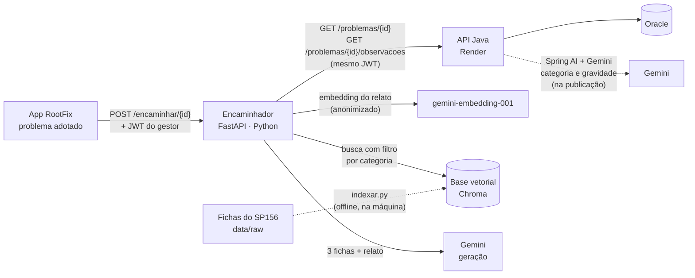

# Arquitetura

## Onde o Encaminhador entra no RootFix

O RootFix tem um app em React Native, uma API Java (comunidades, feed, adoção e login) e uma API .NET (painel do gestor), as duas sobre o mesmo Oracle. Na API Java, o Spring AI com Gemini já classifica categoria e gravidade de cada problema pela foto, na publicação.

O Encaminhador é um serviço separado, em Python, que entra **depois da adoção**: ele diz ao gestor qual serviço da prefeitura resolve o problema e escreve a solicitação. As duas IAs se complementam: uma classifica, a outra encaminha, usando a categoria da primeira como filtro.



## Um encaminhamento, passo a passo

```mermaid
sequenceDiagram
  participant App
  participant IA as Encaminhador
  participant Java as API Java
  participant Base as Base vetorial
  participant Gemini
  App->>IA: POST /encaminhar/2 (JWT do gestor)
  IA->>Java: GET /problemas/2 (mesmo JWT)
  Java-->>IA: problema (adotado, souGestor, categoria, apoios…)
  Note over IA: 403 se não é gestor · 409 se não foi adotado
  IA->>Java: GET /problemas/2/observacoes
  Java-->>IA: observações
  Note over IA: descarta autores e coordenadas;<br/>tira e-mail, telefone, CPF e nº da casa do texto
  IA->>Gemini: embedding do título + descrição (RETRIEVAL_QUERY)
  IA->>Base: busca filtrada pela categoria
  Note over IA,Base: fraca? busca na base toda (plano B da categoria)<br/>abaixo do limiar? "não encontrei", sem chamar o Gemini
  IA->>Gemini: fichas F1–F3 + relato entre <dados_do_morador>
  Gemini-->>IA: ficha escolhida, texto, resumo, motivo (JSON)
  Note over IA: serviço, órgão, canal, prazo e fonte<br/>vêm da ficha, não do modelo
  IA-->>App: encaminhamento
```

Se o Gemini falhar na geração, a resposta traz o serviço e a fonte achados na busca, sem o texto (`textoGerado: false`). Nesse caso, se a ficha for de uma subprefeitura específica, o órgão fica de fora, porque não há quem confira se a ficha vale para a região do problema.

## Componentes

| Arquivo | Responsabilidade |
|---|---|
| `app/main.py` | Rotas: `GET /health`, `POST /simular`, `POST /encaminhar/{id}`; erros e limite de pedidos |
| `app/cliente_java.py` | Chamadas à API Java com o JWT repassado; converte a resposta sem dados de pessoas |
| `app/anonimizacao.py` | Tira e-mail, telefone, CPF e número da casa do texto livre |
| `app/servico.py` | Junta anonimização, busca e geração; recarrega a base se ela for recriada |
| `app/busca.py` | Busca na base com filtro por categoria, plano B e limiar |
| `app/embeddings.py` | Embeddings pelo Gemini (padrão) ou modelo local; assinatura do modelo |
| `app/gerador.py` | Monta o pedido ao Gemini, lê o JSON estruturado, aplica o plano B |
| `app/fichas.py`, `app/preparacao.py` | Validação, limpeza e divisão das fichas em trechos |
| `scripts/` | Validação, indexação, avaliações, medição de memória e teste de integração |

## Decisões e por quê

| Decisão | Motivo |
|---|---|
| Serviço separado em Python, sem mudar a API Java | O ecossistema de IA está em Python; o Java do grupo não precisa de nenhuma alteração |
| Repassar o JWT do gestor em vez de acessar o Oracle | A regra de quem vê o quê fica num lugar só (Java); o serviço não guarda segredo nem acessa o banco |
| RAG em vez de Machine Learning ou visão computacional | A visão já existe no Java; o problema aqui é de conhecimento (qual serviço, qual canal), que está em documentos públicos |
| Embeddings pelo Gemini | O modelo local passou de 770 MB e não cabe nos 512 MB do Render gratuito; com o Gemini o pico foi de 111 MB |
| Base vetorial versionada no Git | O deploy não gasta cota de embeddings; cada pedido faz só uma chamada para o relato |
| Campos factuais vindos da ficha | O modelo só escolhe a ficha e escreve; órgão e prazo não têm como ser inventados nesses campos |
| Limiar antes do Gemini | Problema sem ficha parecida não vai para o modelo, que não tem como inventar um encaminhamento |
| Raciocínio mínimo do Gemini | Escolher entre três fichas e escrever seis frases é tarefa simples; o raciocínio longo só aumentava o tempo |
